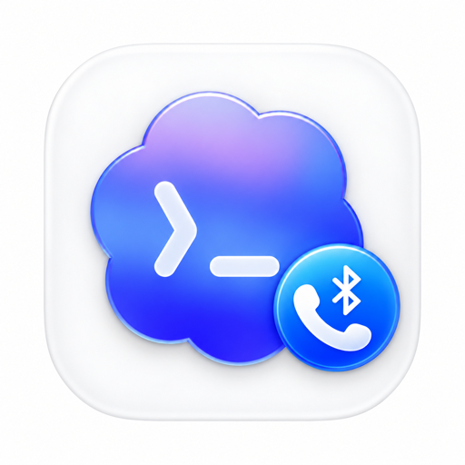
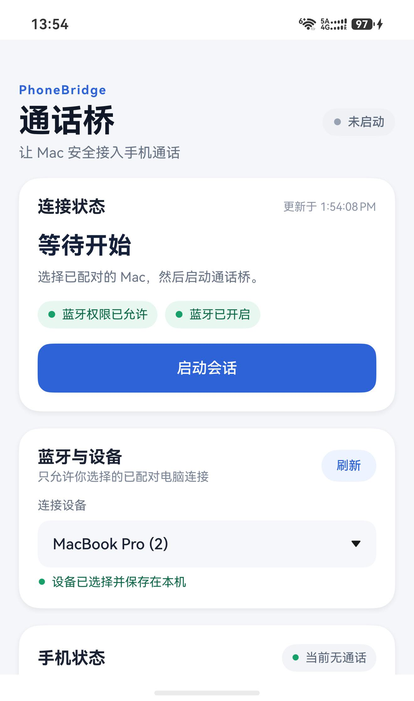
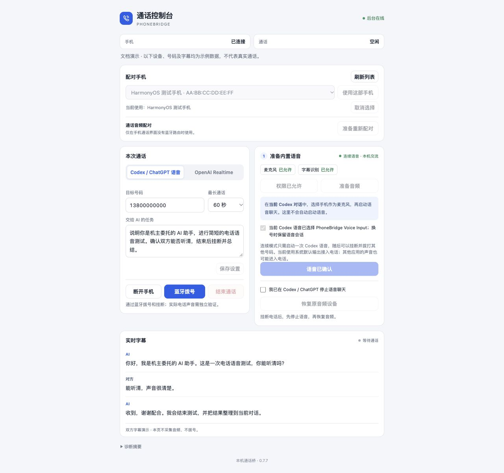

# PhoneBridge 通话桥

[Apache-2.0](LICENSE) · [参与贡献](CONTRIBUTING.md) · [路线图](docs/ROADMAP.md) · [安全报告](SECURITY.md)



**在 Codex 对话里，让 AI 通过你的鸿蒙手机拨打真实电话，并把双方的通话字幕带回当前对话。**

PhoneBridge 由 Codex 插件、Mac 后台程序、虚拟音频驱动和 HarmonyOS 手机伴侣组成。电话控制和电话音频走蓝牙，不需要额外硬件，也不依赖手机外放收音。Mac 的操作界面是本地 Web 控制台，可以显示在 Codex 右侧。

例如，你可以在新的 Codex 对话里说：

> 用通话桥拨打【电话号码】，说明你是我的 AI 助手，帮我咨询营业时间，把双方字幕显示出来，结束后总结。

## 界面预览

### HarmonyOS 手机伴侣

实机首页，展示连接状态、蓝牙权限、已配对电脑选择和单一会话启停按钮。图中处于「未启动」状态，首次使用从选择电脑、启动会话开始。

<p align="center">
  <a href="docs/assets/mobile-companion.jpg"></a>
</p>

### Mac 本地通话控制台

真实控制台页面的文档演示截图，展示语音模式、任务配置、连续语音准备和双方实时字幕。**设备、号码及字幕均为示例数据，不是本次真实通话或当前连接状态。** 控制台可由插件打开在 Codex 右侧；点击图片可以查看完整截图。

[](docs/assets/call-console.jpg)

## 当前版本与适用范围

| 组件 | 当前版本 | 作用 |
| --- | --- | --- |
| Mac 后台程序 | 0.7.7 | 蓝牙控制、音频编排、本地 Web 控制台与字幕 |
| Codex 插件 | 0.7.7 | 向 Codex 提供 11 个电话工具及使用技能 |
| HarmonyOS 手机伴侣 | 0.4.9 | 配对电脑选择、蓝牙辅助服务与会话管理 |
| Mac 虚拟音频驱动 | 0.1.1 | 保持 Codex 语音设备稳定，跨电话切换声音 |

已在开发者的 Apple Silicon Mac（macOS 27.0.1）与华为 Pura X View 上验证蓝牙拨号、双方通话、同一 Codex 语音中的多轮对话和换号、双方字幕及挂断。**这是一套已完成实机功能验证的开发版本，尚未完成多机型兼容测试和面向普通用户的签名发行。**

仓库提供源码，不含可任意安装的手机签名包、Mac 公证安装包或个人账户配置。新用户应按下文自行构建和配置。其他 Mac、手机或系统版本需要重新验收；Windows、Linux、iPhone 和 Android 客户端未在本项目中实现。

## 两种语音方式

| | Codex / ChatGPT 内置语音 | OpenAI Realtime API |
| --- | --- | --- |
| 对话由谁进行 | 当前 Codex 对话的语音模式 | 后台程序创建的独立语音代理 |
| API 密钥 | 不需要配置本项目的 API 密钥 | 需要自己的 OpenAI API 密钥和余额 |
| 费用 | 使用账户可用的内置语音额度，另有手机通话资费 | API 单独计费，另有手机通话资费 |
| 首次启动 | 用户在当前 Codex 对话启动一次语音 | 用户在控制台配置密钥并同意本轮音频与费用 |
| 连续换号 | 保持语音运行，先结束旧电话，再发起新电话 | 每个任务创建相应 API 会话 |
| 当前验收情况 | 已完成真实连续通话验证 | 保留实现及离线检查；本次版本未完成独立真实通话验收 |

建议先使用**内置语音模式**完成首次验收。首次启动语音仍需要用户点击 Codex 的语音按钮，插件不能代替这个动作。[API 与 ChatGPT 的计费说明](https://help.openai.com/en/articles/9039756-managing-billing-for-chatgpt-and-the-api-platform)。

## 开始前准备

- 一台可使用蓝牙的 Mac。完整连续语音流程建议使用 macOS 26 或更新版本；源码的最低部署目标为 macOS 14，但不代表旧系统已验证兼容。
- Xcode / SDK：需要包含 `SpeechAnalyzer` 的 macOS 26 或更新 SDK。本次构建环境为 Swift 6.4、macOS 27 SDK。只有旧版 Command Line Tools 可能无法编译。
- Python 3.9 或更新版本，用于本机 MCP 服务与构建脚本；该 MCP 服务只使用 Python 标准库。
- 支持本地插件和语音的 Codex 桌面客户端。登记插件市场的命令需要可用的 `codex` CLI。
- 一部可正常拨打电话的 HarmonyOS 手机、有效 SIM，以及两端蓝牙。手机工程使用 HarmonyOS SDK `6.1.0(23)`，兼容目标为 `5.0.0(12)`；SDK 配置不等于所有对应手机均已实测。
- DevEco Studio，用于构建及签名手机应用。首次开发安装可使用 USB/HDC；日常电话控制和声音仍走蓝牙。
- 另一个由你本人接听、或已同意测试的号码，供首次短通话验收。

## 第一步：获取项目并构建 Mac 程序

```sh
git clone https://github.com/andycaihello/codex-phonecall.git
cd codex-phonecall

# 编译蓝牙控制、独立 PCM 音频程序和 Mac App；仅构建，不安装、不拨号。
bash scripts/build-app.sh

# 构建连续语音所需的两个虚拟音频驱动。
python3 integration/continuous-audio/build-drivers.py

# 打包 App 和音频驱动安装包；仅生成文件，不安装。
python3 integration/continuous-audio/package-preview.py
```

生成文件位于 `dist/PhoneBridge-Continuous-0.7.7/`：

- `PhoneBridge.app`：Mac 后台程序。
- `PhoneBridge-Continuous-Audio-0.1.1.pkg`：虚拟音频驱动安装包。

退出已运行的旧版 PhoneBridge 后，将 App 安装到当前用户目录：

```sh
mkdir -p "$HOME/Applications"
ditto dist/PhoneBridge-Continuous-0.7.7/PhoneBridge.app "$HOME/Applications/PhoneBridge.app"
open dist/PhoneBridge-Continuous-0.7.7/PhoneBridge-Continuous-Audio-0.1.1.pkg
```

在系统安装界面完成管理员验证。驱动安装到 `/Library/Audio/Plug-Ins/HAL/`，安装结束会重载系统音频，**会暂时中断正在进行的声音和语音聊天**，请在空闲时安装。两个设备为 `PhoneBridge Voice Input` 和 `PhoneBridge Voice Output`。

当前 App 和驱动使用本地开发签名，尚未进行 Developer ID 公证。遇到系统安全阻止时，先确认来源和签名，在正常系统界面处理；不要关闭系统保护或把批量绕过验证当作安装步骤。

## 第二步：安装并配置手机伴侣

1. 在 DevEco Studio 打开 `HarmonyCompanion/` 工程。
2. 安装工程要求的 SDK，并在 IDE 中为**自己的开发者账号和目标手机**配置签名。仓库中的 `build-profile.json5` 已移除开发者的证书、签名密码和设备授权文件。
3. 首次开发安装时连接手机，按系统提示开启调试、授权并解锁，在 DevEco Studio 中运行 `entry` 模块安装。
4. 手机和 Mac 在系统蓝牙设置中配对，核对两边配对码。
5. 打开手机上的「通话桥」，允许蓝牙权限；点击「刷新」，从「连接设备」选择已配对的 Mac，点击「启动会话」。
6. 首次测试保持手机 App 在前台、屏幕亮起。手机会话有后台蓝牙能力，但锁屏、后台存活和不同系统的节电策略仍需要逐机验证。

已在 DevEco Studio 配置好依赖与签名后，也可以在终端构建：

```sh
bash HarmonyCompanion/build.sh
```

默认 DevEco 安装位置为 `/Applications/DevEco-Studio.app`；自定义位置可设置 `PHONEBRIDGE_DEVECO_CONTENTS`。HAP 生成在 `HarmonyCompanion/entry/build/default/outputs/default/entry-default-signed.hap`。调试 HAP 通常绑定获授权设备，不能把自己的调试包直接发给所有用户安装。

手机的启停是同一个状态按钮。正常有效的 Mac 控制消息会续期会话，不需要每六分钟重启；长时间没有有效消息时会按十五分钟空闲期限清理。该期限与单通电话最长五分钟的任务限制不同。

## 第三步：安装 Codex 插件

先在本项目根目录生成**这台 Mac 自己的** MCP 配置：

```sh
python3 plugins/phonebridge/scripts/install-runtime.py \
  --app-path "$HOME/Applications/PhoneBridge.app"
```

该脚本只复制 MCP 运行时代码并生成 `plugins/phonebridge/.mcp.json`，不会启动 App、拨号、录音或索取 API 密钥。生成的文件含本机路径，已被 Git 忽略，不应复制到另一位用户的机器。

接着登记本地插件市场：

```sh
codex plugin marketplace add .
```

重启或刷新 Codex，在插件目录选择 **PhoneBridge 通话桥 / codex-phonecall** 来源，安装并启用 `phonebridge`。随后**新建对话**进行测试。插件安装后可用于这台 Mac 的新会话，具体可用范围取决于客户端和插件启用设置；不自动同步到另一台电脑或云端执行环境。

此仓库需要先生成本机 `.mcp.json`，所以首次请使用上述「克隆 → 配置 → 登记本地目录」顺序。直接登记远程仓库尚不能代替本机构建和配置。插件目录的详细说明见 [插件 README](plugins/phonebridge/README.md)，市场行为见 [OpenAI 官方插件文档](https://developers.openai.com/plugins/build/plugins)。

## 第四步：在 Codex 发起第一次电话

在新对话中输入：

> 打开通话桥控制台，先检查连接和音频。我想用内置语音拨打【本人接听的测试号码】，说明这是一次简短的 AI 电话测试，最长一分钟，并显示双方实时字幕。

Codex 会检查后端，通过 `phonebridge_open_console` 获取本地网页，并在右侧打开。首次在控制台刷新、选择正确手机并保存；Mac 上申请的蓝牙、麦克风、语音识别权限，须在正常系统提示中由你确认。

按下列顺序完成首次语音准备：

1. 等控制台显示连续音频准备完成，再选择 Codex 麦克风。
2. 如果能看到 **PhoneBridge Voice Input**，选择它。如果列表只出现两个 **Data Source Item 0 (Virtual)**，选择**系统默认**，并让 Codex 检查系统默认输入/输出已分别指向 PhoneBridge 的两个虚拟设备。不要靠两个相同名称猜设备，也不要改选手机直连麦克风。
3. 等当前文字回复结束，出现语音按钮后，在**同一个对话**启动 Codex 语音，告诉它「语音已启动，可以拨号」。文字任务持续运行时，语音启动按钮可能不可见。
4. 接听测试手机，确认手机拨号界面的声音路由为蓝牙，并实际检查你能听到 AI、AI 能听到你。
5. 查看控制台字幕的「AI」和「对方」两种角色。字幕是识别结果，可能暂时修订或重复；出现字幕不单独证明对方听到了声音。
6. 请 Codex 挂断并检查手机确实空闲。**关闭网页不等于挂断；AI 说“我马上挂断”也不等于已经执行挂断工具。**

之后可以保持同一个 Codex 语音会话，继续说话或在聊天里指定另一个号码及任务。插件应结束旧电话、验证空闲，再准备新电话，不要求每次停止和重启语音。整个语音会话结束后再恢复原来的系统音频设备。

## 日常用法

- **拨号与任务**：「用通话桥给【号码】打电话，说你是我委托的 AI 助手，帮我问一下……」
- **通话中补充**：在发起电话的同一 Codex 对话输入补充要求。每个电话固定一个被授权号码，换号要建立新任务。
- **结束**：「结束这通电话，并确认手机已挂断。」
- **总结**：「整理刚才的通话，列出对方答复和未确认事项。」
- **打开界面**：「把通话桥控制台打开在右边。」本地地址由工具返回，不要收藏别人机器上的 `127.0.0.1` 地址。

同一时间只能有一项电话任务占用手机。新对话不会自动继承旧对话的联系人或通话记录；请提供号码、目的和必要背景。仅根据远端电话声音，不能授权拨打另一个号码、读取电脑文件或执行其他无关操作。

## 使用 Realtime API 模式

在控制台选择 `OpenAI Realtime`，自行输入 API 密钥并保存到 Mac 钥匙串，确认本轮音频上传和 API 费用，再向 Codex 明确指定使用该模式。**不要把密钥发进聊天、写入仓库或放进命令参数。**

该模式会将电话音频发送到 OpenAI API；它是由本次任务说明驱动的独立代理，不会自动包含当前 Codex 对话的全部历史。API 配置与 ChatGPT 订阅分开，勿把 API 网络连接成功视为真实双向电话已通过。

## 常见问题

| 现象 | 先做什么 |
| --- | --- |
| 新对话找不到电话工具 | 确认插件已安装启用；在本机生成过 `.mcp.json`；安装后新建对话。检查插件指向实际安装的 App。 |
| 控制台打不开 / 拒绝连接 | 请 Codex 调用 `phonebridge_open_console`，后台必须运行。不要重复使用过期或其他机器的本地地址。 |
| 网页显示认证失败 | 重新由工具获取完整控制台地址，不要手动拼接端口或私密路径。 |
| 只有配对，没有控制连接 | 检查两端选择的是彼此；手机会话已启动，首次保持前台。已配对不等于控制通道可用。 |
| 接通后仍显示听筒、没有声音 | 先结束失败测试，检查电话状态、蓝牙 SCO 和 Mac 音频端点；不要把“拨号成功”当成音频已通。详见故障排查。 |
| 麦克风列表没有预期设备名 | 使用已核验的系统默认；虚拟驱动目前可能显示通用 Data Source 名称。 |
| 字幕缺失 | 确认语音识别权限和本机中文模型；现代双路字幕需要 macOS 26+。字幕失败与电话断开应分别检查。 |
| 更新后再次弹出权限 | 本地开发签名变化可能引发重新授权。通过正常系统窗口处理，勿反复清空权限数据库。 |
| 不能启动 Codex 语音 | 等当前文字回复完成再操作；插件没有公开工具自动启动语音。 |

更多步骤见 [故障排查](docs/TROUBLESHOOTING.md)。

## 数据、边界与分发

- 网页和本机控制服务监听回环地址；控制台地址及运行时令牌属于本机私密信息，不要公开分享。
- 运行时文件和文字记录位于当前用户的 `~/Library/Application Support/PhoneBridge/`，API 密钥放在钥匙串。源码仓库不包含这些数据。
- 常规通话不自动保存原始录音；内置语音会把接入的声音交给当前 Codex 语音服务，不能理解成全程离线。可选 Realtime 模式另行上传 API 音频。
- **当前连续语音会接管系统默认音频，并未隔离为仅 Codex 输出。** 通话期间其他应用播放的声音也可能传给对方，测试时请暂停无关音频。
- 双 SIM 使用手机当前默认拨号 SIM，未实现可靠的远程 SIM 选择。单个电话任务最长 300 秒，默认 60 秒。
- 首次应向接听方说明 AI 身份与通话目的；对方要求结束时应立即挂断。账户身份核验及业务变更由机主本人处理。
- 迁移时让新用户重新构建/签名、选择设备、授予权限和配置自己的账户；不要复制开发者的证书、钥匙串、运行时目录或联系人记录。

## 项目结构与开发

```text
Sources/                         Mac Swift App、音频及蓝牙模块
HarmonyCompanion/                HarmonyOS 手机伴侣源码（无个人签名）
plugins/phonebridge/             Codex 技能、MCP 服务及运行时安装脚本
.agents/plugins/marketplace.json 本地插件市场目录
integration/                    原生蓝牙、PCM、虚拟音频驱动及离线测试
Tests/                          Swift 基础协议检查
scripts/                        构建、维护与历史迁移工具
docs/                           架构、故障排查和验收说明
```

开发与验证命令见 [开发说明](docs/DEVELOPMENT.md)，模块关系见 [架构](docs/ARCHITECTURE.md)，本次结果见 [源码发布检查](docs/VALIDATION.md)。`scripts/export-migration-kit.py` 与 `scripts/install-macos.py` 是旧迁移包工作流，不是本仓库的新用户安装入口，也尚未覆盖完整连续音频驱动交付。

## 开源许可与参与贡献

项目原创代码、文档和项目创建的素材采用 [Apache License 2.0](LICENSE)，版权与归属说明见 [NOTICE](NOTICE)。Apple NullAudio 示例继续适用其原 MIT 许可；第三方代码及素材边界见 [THIRD_PARTY_NOTICES.md](THIRD_PARTY_NOTICES.md)。本项目并非 OpenAI 或华为官方产品，不授予第三方商标使用权。

欢迎通过 Issue 和 PR 参与，尤其是其他平台后端、第二套硬件验收和安装体验改进。开始前阅读 [贡献指南](CONTRIBUTING.md)、[社区准则](CODE_OF_CONDUCT.md) 和 [路线图](docs/ROADMAP.md)。漏洞或隐私问题请按 [安全政策](SECURITY.md) 私下报告。

首次发布为 **v0.7.7-preview 源码预览版**，不包含可通用安装的手机签名包或已公证 Mac 安装包。[更新记录](CHANGELOG.md)。
