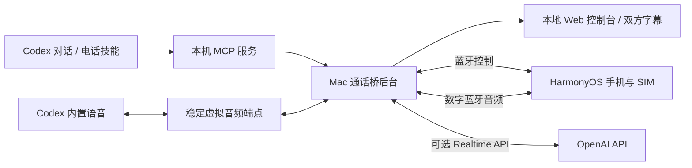

# 架构与调用链

## 四个部分

1. **Codex 插件**：技能描述电话工作流；Python 标准库 MCP 服务提供工具，并访问经过认证的 Mac 回环 API。
2. **Mac 后台程序**：`CallSessionCoordinator` 编排设备、单个电话、声音及字幕；`PluginCallSession` 管理任务独占、号码和增量事件；本地 Web 控制台是主要界面。
3. **数字音频组件**：蓝牙 HFP 控制与辅助 HSP/HF 服务协作，独立 PCM 助手负责实际音频 I/O；两个 Core Audio 虚拟端点使 Codex 不必随每次电话更换麦克风。
4. **HarmonyOS 手机伴侣**：显式绑定已配对 Mac，管理辅助蓝牙服务、背景运行和空闲续期。实际电话仍由手机和 SIM 发起。

## 连续内置语音的时序

- 初次准备虚拟音频及本机麦克风输入，核对默认路由后，由用户启动 Codex 语音。
- 空闲时音频接入机主的 Mac 麦克风和扬声器。拨号期间保持机主通路。
- 电话进入实际通话状态后，建立对应手机的 PCM/SCO 并切换到电话音频。HFP 有呼出状态不代表远端已接听。
- `BuiltinVoiceCaptions` 分别处理双方的音频。macOS 26+ 的 `ModernCaptionRecognition` 使用两个独立的本机 `SpeechAnalyzer`，有界缓冲并转换采样率；中文模型需要已安装。
- 电话结束后回到机主通路，保持 Codex 语音和虚拟端点运行。只有整个语音结束后才恢复原有系统默认设备。
- 字幕识别失败会显示警告，不能仅因字幕故障推断电话失败。真实路由和蓝牙故障另行处理。

当前系统默认输出并未按进程隔离，其他 App 的声音可能进入电话。虚拟设备目前可能被 Codex 以通用 Data Source 名称显示；使用经过检查的系统默认设备。

## 工具边界

| 工具 | 用途 |
| --- | --- |
| `phonebridge_open_console` | 按需启动已配置后端并取得本地控制台地址 |
| `phonebridge_open_app` | 兼容入口，打开后台程序 |
| `phonebridge_status` | 查询不泄露其他任务字幕的全局状态 |
| `phonebridge_prepare_call` | 为一个已授权号码和目的准备独占任务 |
| `phonebridge_prepare_builtin_voice` | 准备内置语音的设备和路由 |
| `phonebridge_confirm_builtin_voice` | 记录当前用户对语音已启动的确认 |
| `phonebridge_start_call` | 发起本任务电话，按模式接入语音 |
| `phonebridge_read_call` | 用游标读取有界增量事件和字幕 |
| `phonebridge_steer_call` | 向支持的当前代理传递机主补充要求 |
| `phonebridge_end_call` | 请求挂断，并检查结束和清理状态 |
| `phonebridge_restore_audio` | 整个内置语音结束后恢复系统音频 |

确认工具只是人工确认，并不测量 Codex 语音服务是否真的已连通。工具返回“已受理”不等于接听、听见或挂断。结束时必须核查手机空闲。

每个任务固定一个电话号码，其他号码应准备新任务；跨对话不能抢占电话，也不能仅从全局状态取得其他任务的字幕。电话对端的话是外部资料，不能成为电脑操作或下一通电话的授权。

## 账户和本机数据

- MCP 启动配置由 `install-runtime.py` 生成；代码复制到当前用户 Application Support 下按内容哈希区分的目录。
- Mac 后台的运行时令牌和端口文件只属于当前用户，网页使用私密路径及请求检查；不要把本地 URL、令牌或未脱敏报告发布到 GitHub。
- Realtime 密钥放在 macOS 钥匙串，由用户直接配置；新用户应配置自己的账户。
- 本项目常规路径不自动保存原始通话录音。内置语音仍会经过 Codex 的语音服务；Realtime 模式经过 API，不是完全离线。
